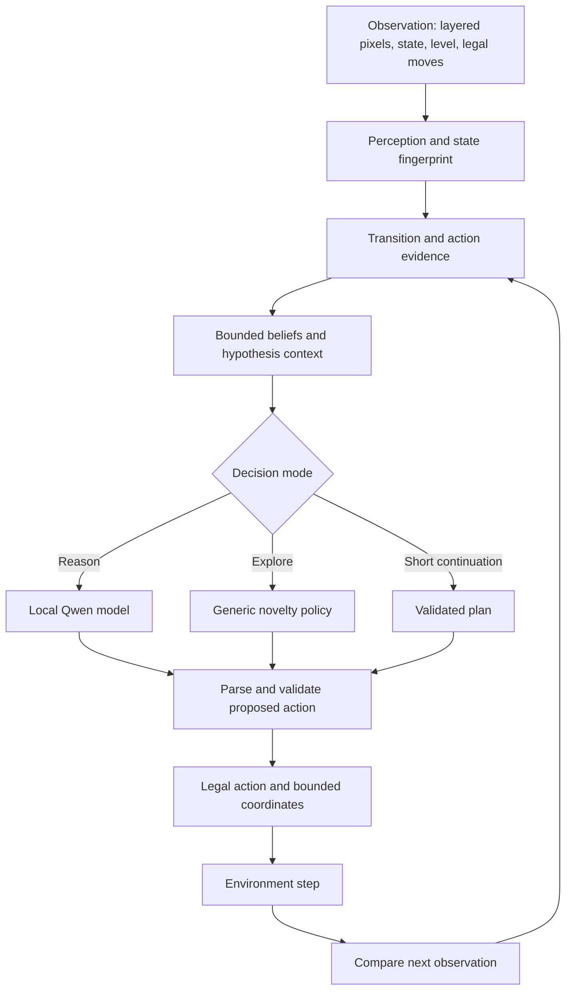

# Architecture: a small baseline and a measured research line

This page describes **two different source states**. The default `agent/my_agent.py` is the EXP-000 control; the richer Qwen architecture is **opt-in source included in this repository for engineering review**, originally developed in [EXP-019](https://github.com/glaucojrcarvalho/arc-agi-3-agent/pull/25) at [commit `6c4224b`](https://github.com/glaucojrcarvalho/arc-agi-3-agent/tree/6c4224b514b6bd3e99ec8bf89c957ffaa092afd3). Do not assume the experimental modules are present in a fresh `main` checkout.

## Data and decision flow (experimental)

A prior observation can show changed pixels without any goal progress. Verified progress requires an **authoritative increase in `levels_completed`**. That rule is central to the experiment design and prevents incorrectly rewarding animation and cosmetic state changes.

## Components and responsibilities

| Concern | Experimental component | Responsibility and constraint |
| --- | --- | --- |
| Observation | `src/arc_agent/perception.py`, `state.py` | Lossless spatial representation / frame difference; avoid assuming changed pixels are success |
| Transition integrity | `transition_policy.py` | Observe actual after-action state; suppress provable no-ops conservatively |
| Reasoning context | `reasoning_memory.py`, `action_evidence.py` | Bounded, provisional hypotheses and factual action attempts; no invented mechanics |
| Inference | `model.py` and `agent/exp005_agent.py` | Local Qwen3.8-27B FP8 through an offline serving process in configured Kaggle experiments |
| Action choice | `novelty_explorer.py` and short-plan logic | Lower inference overhead when stalled; invalidate stale plans after observed changes |
| Contract | `actions.py` and agent integration tests | Validate structured output and available actions; constrain click coordinates |
| Packaging | `scripts/build_kaggle_exp005_notebook.py` | Offline notebook construction distinct from public smoke tests and competition submission |

The paths above are present in this consolidated code tree. The [EXP-019 source snapshot](https://github.com/glaucojrcarvalho/arc-agi-3-agent/tree/6c4224b514b6bd3e99ec8bf89c957ffaa092afd3) remains immutable for provenance. The default agent is still EXP-000; use `agent/exp005_agent.py` explicitly for the model-based research line.

## Key engineering decisions

1. **Bound memory and prompts.** Store only limited evidence needed for the next decision, not unrestricted full-resolution history. Traces are game-local unless an experiment explicitly tests cross-level transfer.
2. **Separate observation from hypothesis.** Model guesses are provisional. Only environment counters can verify a completed level.
3. **Guard the action contract.** Invalid JSON, unavailable actions, stale coordinate plans, and reset-state mismatches should be handled explicitly rather than silently treated as progress.
4. **Measure the cost of cognition.** Compare model calls, first-level completion, total completed levels, action counts, failures, and wallclock against the same public-game protocol.
5. **Keep reproducibility tiers separate.** Unit tests and deterministic fake-model probes verify implementation, while real Qwen and official Kaggle scores answer different questions.

## Failure-driven evolution

- Early real-Qwen probes failed to complete levels under short action budgets; changed pixels and repeated clicks were misleading signals ([EXP-003](https://github.com/glaucojrcarvalho/arc-agi-3-agent/pull/8), [EXP-004](https://github.com/glaucojrcarvalho/arc-agi-3-agent/pull/9)).
- A public-probe constructor mismatch and a reset-action contract error were corrected without attributing a false model improvement ([EXP-005 fix](https://github.com/glaucojrcarvalho/arc-agi-3-agent/pull/11), [EXP-007](https://github.com/glaucojrcarvalho/arc-agi-3-agent/pull/13)).
- Excess animation context caused a real inference-context failure; later experiments bounded prompt content ([EXP-008](https://github.com/glaucojrcarvalho/arc-agi-3-agent/pull/14)).
- Action attempt ledgers and observed-completion memory were isolated as hypotheses, **not** automatically promoted ([EXP-019](https://github.com/glaucojrcarvalho/arc-agi-3-agent/pull/25), [EXP-023](https://github.com/glaucojrcarvalho/arc-agi-3-agent/pull/28)).

## Execution boundary

The competition requires an offline notebook with a runtime limit. The public repository does not ship Kaggle credentials, model checkpoints, private game recordings, or generated submission artifacts. Public smoke tests must not be described as hidden competition scoring. See [setup](setup.md), [publication policy](publication-policy.md), and [evidence ledger](experiment-evidence.md).
